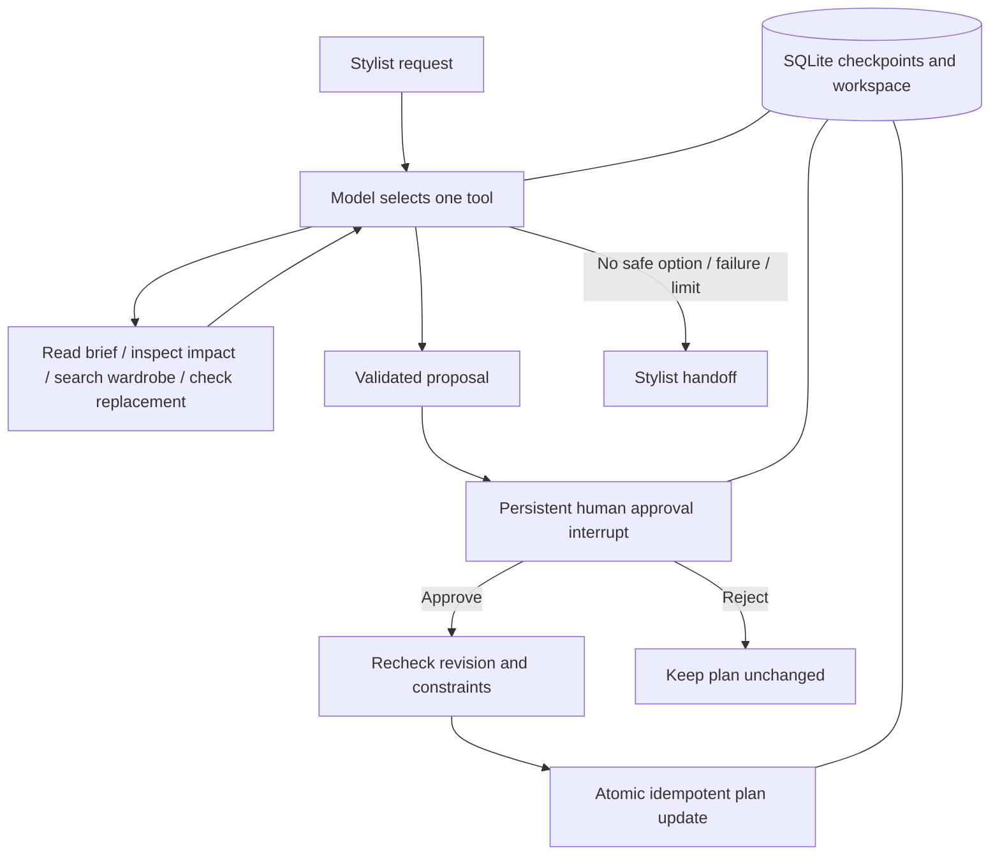

# FitLore Rescue submission

Download and extract `FitLore-Rescue-Source.zip`, then follow setup below. The archive includes the complete runnable directory structure, 25 tests, dependency lockfile and live evaluation harness. Credentials and runtime databases are excluded.

# FitLore Rescue

A local shoot-recovery agent that investigates an unavailable garment, checks replacement garments, and pauses for human approval before updating affected looks.

Built on FitLore's fashion-production concept and visual identity. Week 3 adds a new model-selected tool loop, durable LangGraph checkpoints, bounded recovery, and an idempotent approval transaction. This is a focused companion prototype, not a migration of the Week 2 database.

## Run

Python 3.12 recommended.

```sh
python3 -m venv .venv
.venv/bin/python -m pip install -r requirements.txt
cp .env.example .env
# Add your Nebius key and model to .env. Never commit .env.
FITLORE_ALLOW_MODEL=true .venv/bin/python -m uvicorn app.main:app --host 127.0.0.1 --port 8033
```

Open http://127.0.0.1:8033. Select **Rehearsal · no AI** for deterministic offline testing. Live mode requires Nebius and uses a durable request ceiling per runtime directory (default 20; this session explicitly authorized 80 using `FITLORE_REQUEST_LIMIT=80`). Attempts count even when requests fail; they do not represent dollars. The application does not automatically reset this allowance.

Alternatively, set `FITLORE_CREDENTIALS_FILE` to an existing dotenv file; only NEBIUS_API_KEY, NEBIUS_MODEL and NEBIUS_BASE_URL are read from it. Credentials remain server-side.

## Agent architecture



The model outputs a schema-constrained action. Python dispatches only allowlisted tools; the model cannot execute code or directly write the project. `check_replacement` enforces category, availability, color, recorded size, sleeve coverage, ready time, and replacement cost. A proposal requires successful reads and a successful candidate check. Approval uses LangGraph `interrupt()` and `Command(resume=...)`.

`app/agent.py` holds the model prompt, tools and graph. `app/store.py` holds the durable workspace, event log, model attempt ledger and transaction. `app/fixtures.py` defines fictional data. `app/main.py` exposes the local UI and API. `web/` contains the interface and licensed category photography inherited from FitLore.

## Validation

```sh
.venv/bin/python -m pytest -q
```

Automated tests use an explicitly deterministic decision driver. They validate control flow and integrity; they are not live model quality evaluations. Live evidence is exported separately in `output/submission/live-evidence.json`.

Two exploratory Nebius runs were inspected: transient inventory failure recovered to an approved plan; no qualifying garment led to handoff with no write. The model made unnecessary reads and initially selected invalid candidates in the no-match case. Constraint checks rejected them. A subsequent ten-case live evaluation passed 10/10 defined acceptance criteria in under seven seconds per case, excluding human review time. It covers standard recovery, retries, outage, no match, reject, custom white shirt, low budget, untrusted brief instructions, stale approval and size mismatch. See `output/submission/live-evaluation.json`. The approvals in this evaluation were simulated by the test harness. 25 deterministic tests also pass. This small fictional sample is not a general success-rate claim.

## Scope

- Editable saved shoots with validated CSV inventory and look references. Approval updates the saved shoot atomically; concurrent edits invalidate stale proposals. The separate fictional demo has eight garments and two looks.
- Single operator on localhost; no multi-user authentication or remote deployment.
- No retailer search, real stock verification, bookings, payments, messages, vision analysis or physical fit guarantee.
- Approval changes look assignments only. Stylist fit and photographer approval remain open.
- Memory means durable run state and audit history, not learned preferences or cross-project retrieval.
- The fixed rescue workflow is not a general styling assistant. The request text guides investigation within that scope.
- A maximum of ten model-selected steps per run and two inventory failures prevents endless loops. Model/network failures hand off without a project update.

## References

- [LangGraph interrupts](https://docs.langchain.com/oss/python/langgraph/interrupts)
- [LangGraph persistence](https://docs.langchain.com/oss/python/langgraph/persistence)
- Photography attribution: `web/images/credits.json` and `/static/credits.html`.

## Submission

Report: https://docs.google.com/document/d/1unQyGjH-shQhOp4D55r3fNvyWaWiowYcRQ2m696kLkY/edit . Local report, evidence, handout comparison and recording guide are in `output/submission/`. Reviewer access must be verified before submission. The final video must show a live application run and stay under five minutes. Publish the sanitized source package to the intended GitHub repository; no credentials or runtime databases belong in that repository.

## Editable workflow

Choose Create or edit a shoot, edit the brief and constraints, paste/upload wardrobe CSV, and define looks using garment IDs. Save locally, then start a standard investigation. Live mode sends the selected records to Nebius. Fault injection is restricted to the fictional demo. At review, select the proposal or another validated candidate, add a note and approve or reject. Editing the shoot while approval is pending blocks the stale transaction.

Runtime data stays in `data/runtime` until the operator removes it. Do not commit it. Tests isolate their databases in temporary directories. The live evaluation uses the shared ledger and stops at 74 requests to preserve six of this session’s authorized 80. Run it only with a suitable explicit provider budget.
